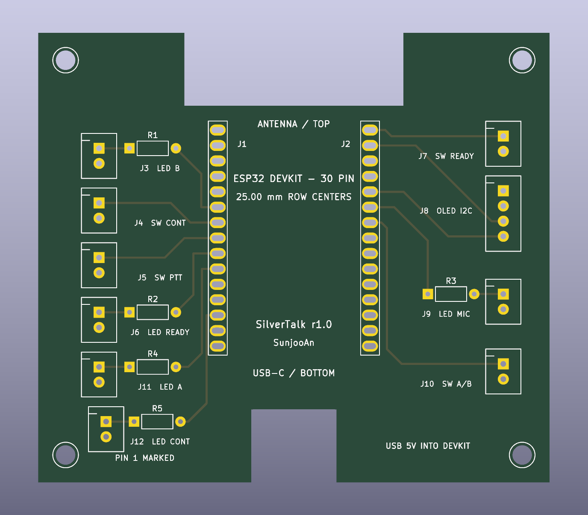

# SilverTalk DevKit 캐리어 PCB r1.0

제작자 SunjooAn · 갤럭시 앱 1.10 · ESP32 DevKit 펌웨어 1.8

SilverTalk의 패널 부품을 배선 하네스로 꽂고, ESP32 DevKit을 교체할 수 있는 2층 캐리어입니다. 대상은 ESP32-WROOM-32 USB-C DevKit 중 **양쪽 15핀, 한 줄 피치 2.54 mm, 두 줄 중심 간격 25.00 mm**인 보드입니다.

## 주문 전 맞춤 확인

- 부품면에서 안테나를 위로 두었을 때 왼쪽 줄 맨 위는 `EN`, 오른쪽 줄 맨 위는 `23`입니다. USB-C 쪽 왼쪽 끝은 `VIN`, 오른쪽 끝은 `3V3`입니다. 보드의 인쇄 표기와 키캐드 회로도에서 이 방향과 실제 GPIO 순서를 확인하세요.
- [소켓 맞춤 1:1 도면](소켓맞춤-1대1.svg)을 100%로 인쇄하고, 도면의 25 mm 선을 자로 확인한 뒤 DevKit을 얹어 보세요. 두 줄 중심은 25.00 mm이며, 각 줄의 첫 핀부터 끝 핀까지는 35.56 mm입니다.
- 두 개의 독립 암헤더를 DevKit에 먼저 끼우고 캐리어의 홈에 넣어 위치를 맞춥니다. 가로 2.00 × 세로 1.00 mm 도금 슬롯 안에서 암헤더를 맞춘 다음 두 줄의 끝 핀을 먼저 납땜하세요. DevKit을 뺐다가 다시 끼워 맞춤을 확인한 뒤 나머지 핀을 납땜합니다.

## PCB 주문

JLC3DP에서 **PCB/PCBA** 메뉴를 선택하면 JLCPCB의 PCB 주문 화면으로 이동합니다. 그 화면에 `SilverTalk-DevKit-Carrier-r1.0-JLCPCB-Gerber.zip`을 올리세요. [JLC3DP 공식 주문 안내](https://jlc3dp.com/help/article/how-to-combine-orders-for-jlc3dp-and-jlcpcb-products)

| 항목 | 주문 설정 |
| --- | --- |
| 소재·층수 | FR-4, 2층 |
| 외곽 크기 | 84 × 74 mm. 위쪽 안테나 홈 36 × 12 mm, 아래쪽 USB-C 케이블 홈 14 × 12 mm |
| 형태·수량 | Standard PCB/PCBA · Single PCB · Different Design 1 · 프로토타입 5장 |
| 두께·동박 | 1.6 mm, 외층 1 oz |
| 색상·표면처리 | Green · White 실크 · LeadFree HASL |
| 조립 | PCB Assembly 끔 · Stencil 끔. 스루홀 부품은 직접 납땜 |
| 드릴 | PTH 62개 중 가로 도금 슬롯 30개, NPTH Ø3.2 mm 고정 홀 4개 |
| 슬롯 옵션 | Blind Slots No. 소켓 슬롯은 기판을 관통하는 2.00 × 1.00 mm 도금 슬롯 |
| 제조 파일 확인 | Confirm Production File Yes · Do not confirm automatically 체크 |

JLCPCB 견적 화면에서 2층과 84 × 74 mm 인식을 확인했고, 뷰어의 드릴 레이어에서 소켓 슬롯 30개와 고정 홀 4개를 확인했습니다. 주문 전 미리보기에서 같은 외곽과 홀을 대조하세요. ZIP에는 거버 7개, Excellon 드릴 2개, 거버 작업 정보가 들어 있습니다. [JLCPCB 거버·드릴 안내](https://jlcpcb.com/help/article/how-to-generate-gerber-and-drill-files-in-kicad-8) · [제조 파일 확인 안내](https://jlcpcb.com/kr/help/article/how-to-confirm-the-production-file)

## 커넥터 핀

모든 2핀 커넥터에서 **1번은 신호 또는 LED 양극, 2번은 GND**입니다. PCB의 사각 패드와 짧은 실크 표식이 1번입니다. 스위치는 닫을 때 GPIO를 GND에 연결합니다. 아래 번호는 부품면 기준입니다.

| 커넥터 | 연결 부품 | 1번 | 2번 |
| --- | --- | --- | --- |
| J3 | 서비스 B LED | GPIO32 → R1 → LED 양극 | LED 음극 |
| J4 | 연속 대화 버튼 | GPIO33 | GND |
| J5 | 말하기 PTT 버튼 | GPIO25 | GND |
| J6 | 대기 버튼 LED | GPIO26 → R2 → LED 양극 | LED 음극 |
| J7 | 대기·깨우기 버튼 | GPIO23 | GND |
| J9 | 마이크 LED | GPIO19 → R3 → LED 양극 | LED 음극 |
| J10 | 서비스 A/B 전환 스위치 | GPIO18 | GND |
| J11 | 서비스 A LED | GPIO27 → R4 → LED 양극 | LED 음극 |
| J12 | 연속 대화 LED | GPIO13 → R5 → LED 양극 | LED 음극 |

**J8 OLED**는 1번 GND, 2번 3V3, 3번 SCL(GPIO22), 4번 SDA(GPIO21)입니다. OLED 모듈에 인쇄된 이름끼리 연결하세요. 3.3 V SSD1306 I²C 128×64, 주소 0x3C를 사용합니다.

J10을 개방하면 A, GND에 연결하면 B입니다. J4·J5·J7에는 순간식 NO 버튼을 사용합니다. LED의 저항은 PCB에 장착하므로 각 LED는 해당 커넥터에 양극과 음극을 연결합니다.

## 부품표

| 수량 | 품목과 규격 |
| --- | --- |
| 1 | ESP32-WROOM-32 USB-C DevKit, 30핀, 4MB, 실물 핀 배열 확인 |
| 2 | J1·J2 — 1×15, 2.54 mm, 수직 스루홀 암헤더 |
| 9 | J3–J7, J9–J12 — JST XH 2핀 PCB 헤더 B2B-XH-A 및 짝 하우징 XHP-2 |
| 1 | J8 — JST XH 4핀 PCB 헤더 B4B-XH-A 및 짝 하우징 XHP-4 |
| 22 | JST XH 암 크림프 단자 SXH-001T-P0.6 또는 규격에 맞는 사전 압착 케이블 |
| 5 | R1–R5 — 220 Ω, 1/4 W, 축형, 리드 간격 7.62 mm |
| 5 | 5 mm LED, 낮은 순방향 전압의 고효율형 |
| 3 | 순간식 NO 버튼, 패널 장착형 |
| 1 | 유지형 SPST ON/OFF 스위치, 패널 장착형 |
| 1 | SSD1306 I²C OLED 모듈, 4선 |
| 4 | M3 스페이서와 나사, PCB 홀 Ø3.2 mm |

JST XH 커넥터의 피치는 **2.50 mm**입니다. [JST XH 공식 도면](https://www.jst-mfg.com/product/pdf/eng/eXH.pdf)

## 국내 구매와 직접 압착

다음 수량은 PCB 한 장에 모든 패널 부품을 연결하는 기준입니다.

| 부품 | 필요한 수량 | 국내 구매처 |
| --- | ---: | --- |
| ESP32 소켓. 1×15, 2.54 mm, 수직 스루홀 암헤더 | 2개 | [디바이스마트 1×15 암헤더](https://www.devicemart.co.kr/goods/view?no=12497) |
| PCB용 2핀 수헤더 `B2B-XH-A` | 9개 | [레고전자부품 B2B-XH-A](https://regoelec.co.kr/product/detail.html?product_no=3910) |
| PCB용 4핀 수헤더 `B4B-XH-A` | 1개 | [레고전자부품 B4B-XH-A](https://regoelec.co.kr/product/detail.html?product_no=3912) |
| 배선용 2핀 암 하우징 `XHP-02` | 9개 | [레고전자부품 XHP-02](https://regoelec.co.kr/product/detail.html?product_no=3905) |
| 배선용 4핀 암 하우징 `XHP-04` | 1개 | [레고전자부품 XHP-04](https://regoelec.co.kr/product/detail.html?product_no=3907) |
| 두 하우징에 공통으로 쓰는 암 압착 단자 `SXH-001T-P0.6` | 22개 | [레고전자부품 SXH-001T-P0.6](https://regoelec.co.kr/product/detail.html?product_no=3920) |

암 하우징은 각각 `1EA` 옵션을 선택하고, 압착 단자는 이 판매처의 최소 옵션인 `100EA` 한 팩을 선택합니다. 부품을 확인했을 때 하우징 10개와 단자 한 팩은 합계 2,485원이었으며, 전선과 배송비는 별도입니다.

AWG 26 연선에 암 단자를 압착하고 하우징에 끼웁니다. J8은 **1 GND, 2 3V3, 3 SCL, 4 SDA**를 기준으로 하네스 전선에 표시한 뒤 OLED 모듈의 핀 이름끼리 연결하세요.

완성 하네스를 사용할 경우에는 [로봇사이언스몰 2핀 JST XH 호환 하네스](https://robotscience.kr/goods/view?no=16652) 9세트와 [디바이스마트 4핀 JST XH 호환 하네스](https://www.devicemart.co.kr/goods/view?no=15574781) 1세트를 준비합니다. 각 세트에서 PCB의 수헤더에 꽂히는 전선 쪽 암 커넥터를 사용합니다.

## 조립 후 확인

1. 전원을 분리한 상태에서 암헤더, 저항, JST 헤더를 납땜하고 3V3와 GND 사이 단락 여부를 확인합니다.
2. 안테나가 위쪽 홈을 향하고 USB-C가 아래쪽 홈을 향하도록 DevKit을 끼웁니다. 안테나 위·뒤에 금속 스페이서, 전선 뭉치, 금속 케이스가 가까이 오지 않도록 배치합니다. [Espressif ESP32 안테나 배치 가이드](https://docs.espressif.com/projects/esp-hardware-design-guidelines/en/latest/esp32/pcb-layout-design.html)
3. 각 커넥터에 패널 부품을 꽂고 DevKit 자체 USB-C로 전원을 공급합니다. 유선 제어에는 DevKit USB-C를 기존 갤럭시 PD 허브에 연결합니다.
4. OLED 표시, A/B 전환, 대기 버튼, PTT, 연속 대화 버튼과 해당 LED를 차례로 확인합니다. 펌웨어는 기존 1.8을 그대로 사용합니다. [펌웨어 플래싱 안내](펌웨어-플래싱.md)

## 설계 검증

KiCad 9.0.8에서 전기 규칙 검사(ERC), PCB 설계 규칙 검사(DRC), 회로도와 PCB 대조를 실행했습니다. 각각 0건이며 미연결 패드도 0건입니다. 제조용 거버 외곽은 84 × 74 mm이고, 별도 드릴 파일에 도금 슬롯 30개와 비도금 Ø3.2 mm 홀 4개가 있습니다. 실물 소켓 맞춤과 제작 후 기능 검증은 프로토타입 조립 때 확인합니다.
