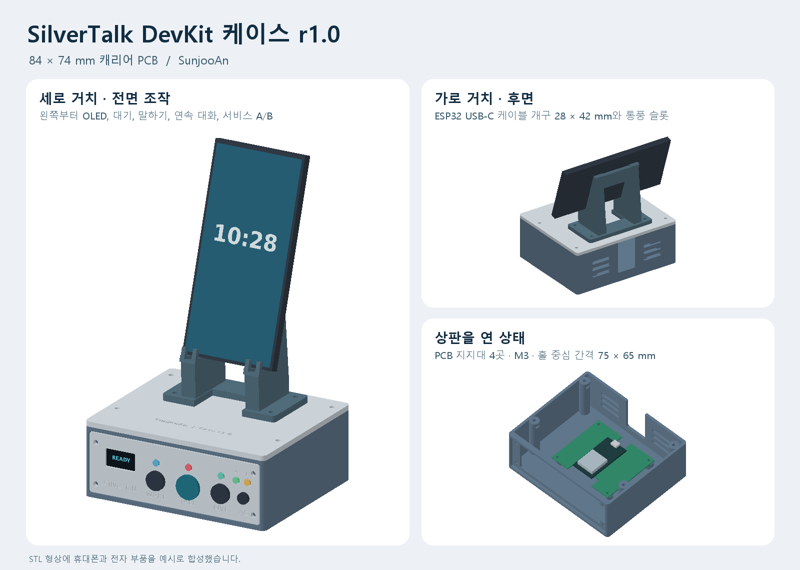

# SilverTalk DevKit 케이스 r1.0

제작자 SunjooAn · 캐리어 PCB r1.0 · ESP32 펌웨어 1.8 · 갤럭시 앱 1.10

84 × 74 mm 캐리어 PCB를 기준으로 설계했습니다. 전면판, 상판, 갤럭시 거치대를 분리할 수 있습니다. 전면 중앙의 말하기 버튼은 대기·연속 대화 버튼보다 크게 배치했습니다.



## JLC3DP 주문

ZIP을 푼 뒤 `STL` 폴더의 **4개 파일을 각각 모델로 추가**하고, 각 수량을 1개로 설정합니다. 공정은 `MJF`, 소재는 `PA12-HP Nylon`을 기준으로 설계했습니다. 각 미리보기에서 아래 치수가 **mm**로 인식되는지 확인하세요. 전면판은 STL에서 눕혀 놓았습니다. [JLC3DP 주문 안내](https://jlc3dp.com/help/article/how-to-place-a-3d-printing-order) · [PA12-HP Nylon 규격](https://jlc3dp.com/help/article/pa12-hp-nylon)

| STL | 부품 | 크기 (mm) |
| --- | --- | --- |
| `SilverTalk-r1.0-01-Body.stl` | 본체, PCB 지지대와 뒤쪽 통풍구 | 150 × 126 × 54 |
| `SilverTalk-r1.0-02-Front.stl` | OLED·버튼·LED 교체형 전면판 | 141.1 × 46.3 × 3.1 |
| `SilverTalk-r1.0-03-Lid.stl` | 분리형 상판, 제작자 및 버전 각인 | 150 × 126 × 4 |
| `SilverTalk-r1.0-04-Galaxy-Dock.stl` | 가로·세로 공용 거치대 | 94 × 50 × 84.29 |

케이스는 상판까지 150 × 126 × 58 mm이며, 거치대까지 총높이는 약 142.3 mm입니다. 뒤쪽 ESP32 USB-C 케이블 개구는 28 × 42 mm입니다. 거치대에는 충전 플러그를 위한 중앙 간격 40 mm와 휴대폰 하단 스피커를 위한 홈이 있습니다. 거치 각도는 수직에서 뒤로 18°입니다.

## 출력 전 실물 대조

[1:1 전면 도면](front-panel-1to1.svg)을 100%로 인쇄하고, 도면의 50 mm 기준선을 자로 확인한 다음 부품을 대보세요. 기존 PCB의 패널 부품표는 전기 규격만 정하므로 아래 장착 치수를 기준으로 설계했습니다.

| 위치 | 사용할 부품 | 가공 치수 | PCB 연결 |
| --- | --- | --- | --- |
| OLED | SSD1306 0.96″ I²C, 128 × 64. 약 27 × 27 mm 모듈 | 표시 창 24.8 × 14.0 mm | J8 |
| 대기 `WAKE` | M12 순간식 NO 버튼, 본체 외경 Ø14 mm 이내 | Ø12.7 mm | J7 버튼 · J6 LED |
| 말하기 `TALK` | M16 순간식 NO 버튼, 본체 외경 Ø18 mm 이내 | Ø16.7 mm | J5 버튼 · J9 마이크 LED |
| 연속 대화 `LIVE` | M12 순간식 NO 버튼, 본체 외경 Ø14 mm 이내 | Ø12.7 mm | J4 버튼 · J12 LED |
| 서비스 `A/B` | M6 유지형 SPST 토글, 본체 폭 8.5 mm 이내 | Ø6.7 mm | J10 스위치 · J11 A LED · J3 B LED |
| 상태 LED 5개 | Ø5 mm LED, 플랜지 Ø6.2 mm 이내 | Ø5.6 mm × 5 | 각 기능의 LED 커넥터 |

- 버튼·스위치의 패널 장착 허용 두께는 3.1 mm 이상이어야 합니다. 버튼 몸체와 배선이 전면판 뒤로 약 25 mm 안에 들어오도록 실물에서 확인하세요.
- OLED는 창에 표시 영역을 맞춘 뒤 모듈 뒤쪽 배선이 위나 아래로 향하도록 조립합니다. 모듈 가장자리에 얇은 절연 양면테이프를 붙여 전면판 뒤에서 고정합니다. 다리가 달린 LED는 뒤에서 끼우고 플랜지에 소량의 전자부품용 중성 경화 실리콘을 발라 고정합니다.
- 갤럭시 A20(158.4 × 74.7 × 7.8 mm)을 기준으로, **케이스를 씌운 두께 13.5 mm 이하**까지 모델에서 확인했습니다. 접이식 링과 손잡이처럼 튀어나온 부분을 포함해서 재세요. 세로 상태에서 충전 플러그와 스트레인 릴리프가 휴대폰 아래로 22 mm를 넘으면 ㄱ자 USB-C 플러그를 사용하세요. 가로로 돌릴 때는 충전 포트가 있는 옆으로 케이블을 뺍니다. [삼성 갤럭시 A20 치수](https://www.samsung.com/us/business/support/owners/product/galaxy-a20-unl/)
- ESP32의 포트와 케이블은 장착 상태에서 대보세요. 중앙 통로에는 폭 20 mm × 높이 14 mm의 플러그 공간을 확보했습니다. 몰딩 길이 25 mm 이하의 USB-C 플러그를 장착 기준으로 삼았습니다. 전면 부품 전선은 본체 좌우로 보내 ESP32 안테나 앞쪽과 USB-C 뒤쪽을 비워 두세요.

## 체결 부품과 조립

| 위치 | 한 대 기준 준비물 |
| --- | --- |
| PCB → 본체 | M3×12 나사 4개, M3 사각너트 4개, M3 평와셔 4개. 사각너트는 DIN 562 또는 폭 5.5 mm × 높이 1.8 mm 규격 |
| 전면판 → 본체 | M3×12 나사 4개, M3 너트 4개, M3 평와셔 4개 |
| 거치대 → 상판 | M3×14 나사 4개, M3 너트 4개, M3 평와셔 4개 |
| 상판 → 본체 | M3×12 나사 4개, M3 사각너트 4개, M3 평와셔 4개 |
| 미끄럼 방지 | 본체 바닥 모서리용 접착식 고무발 4개, 필요하면 거치대 접촉부에 0.5 mm 이하 보호 패드 |

1. 전면판 뒤에서 OLED와 LED를 붙이고 버튼과 토글의 패널 너트를 조입니다. 전면판을 본체에 끼워 나사 4개를 넣고 열린 상단을 통해 안쪽 너트를 조입니다.
2. 본체 바닥에서 PCB 지지대 4개의 사각 홈에 너트를 넣고 저점착 테이프로 잠시 잡아 둡니다. PCB와 와셔를 올려 위에서 M3×12 나사를 조입니다. PCB 안테나 홈은 전면을 향하고 DevKit USB-C 포트는 후면을 향합니다.
3. J3–J12 하네스를 부품과 연결합니다. M3 나사가 PCB와 다른 전선에 닿지 않는지 확인한 뒤 ESP32 USB-C 케이블을 후면 홈으로 뺍니다. [PCB 핀·하네스 안내](https://github.com/sunjoo1968-design/SilverTalk-DevKit/tree/main/devkit-controller/hardware/carrier-r1.0#커넥터-핀)
4. 거치대를 분리된 상판 위에 올리고 M3×14로 먼저 고정합니다. 본체 네 기둥의 옆 슬롯에 사각너트를 밀어 넣고 상판을 덮은 뒤 M3×12로 고정합니다.
5. 바닥에 고무발을 붙입니다. 갤럭시를 가로·세로로 올려 케이블에 눌리는 곳이 없는지 확인합니다. OLED, 대기, 말하기, 연속 대화, A/B와 각 LED를 시험한 뒤 갤럭시 스피커에서 음성이 들리는지 확인합니다.

## 검증과 재생성

캐리어 PCB 제조용 드릴의 Ø3.2 mm 고정홀 4개와 Gerber 외곽을 대조했습니다. 4개 STL은 각각 닫힌 단일 셸이며, 메시를 다시 읽어 검사했습니다. CAD에서 PCB, 30핀 DevKit 여유 공간, 후면 케이블, 나사 통로와 가로·세로 거치 간섭을 검사했습니다. 실물 부품을 끼운 상태, 출력 수축과 뒤틀림, JLC3DP 제조 검토는 아직 확인하지 않았습니다. 세부 결과는 `mesh-check.json`에 있습니다.

CAD를 수정하거나 STL을 다시 만들려면 프로젝트의 `generate_enclosure.py`에서 부품 치수를 바꾸고 실행합니다.

```powershell
python -m pip install manifold3d==3.5.5 trimesh==5.2.1 numpy matplotlib networkx
python generate_enclosure.py
```
